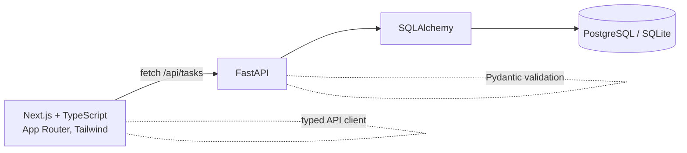

# Taskboard — Full-Stack (Next.js + FastAPI)

> A small, production-shaped full-stack app: a **Next.js + TypeScript** frontend on a
> **FastAPI + SQLAlchemy** backend, with Postgres, Docker Compose and CI. Create tasks,
> advance their status, filter and delete.


> ℹ️ An **original demo application** built to show full-stack practices end to end
> (typed API client, validation on both ends, tests, containerization, CI). No proprietary
> code or data.

---

## 🏗 Architecture



- **Frontend** — Next.js App Router, a typed [`lib/api.ts`](frontend/lib/api.ts) client, and
  presentational components (`TaskForm`, `TaskList`, `StatusBadge`). Client-side data fetching
  with loading/error states.
- **Backend** — FastAPI routers → `crud` → SQLAlchemy models, with Pydantic request/response
  schemas. SQLite by default (zero-config); `DATABASE_URL` switches it to Postgres.
- Clean separation: validation on both ends, CORS configured, a `/health` endpoint.

---

## 🛠 Tech Stack

- **Frontend:** Next.js 14, React 18, TypeScript, Tailwind CSS
- **Backend:** FastAPI, SQLAlchemy 2, Pydantic v2, Uvicorn
- **Database:** PostgreSQL (SQLite for local dev/tests)
- **Infra:** Docker + Docker Compose (db + api + web)
- **CI:** GitHub Actions — backend `pytest`, frontend `lint` + `build`

---

## 🚀 Run it

### Docker Compose (everything)
```bash
docker compose up --build
# Frontend: http://localhost:3000   API docs: http://localhost:8000/docs
```

### Locally (two terminals)
```bash
# backend
cd backend && python -m venv .venv && . .venv/Scripts/activate
pip install -r requirements.txt
uvicorn app.main:app --reload            # http://localhost:8000

# frontend
cd frontend && npm install
cp .env.local.example .env.local
npm run dev                              # http://localhost:3000
```

---

## ✅ Tests & checks (run in CI)

```bash
cd backend  && pytest -q        # 6 tests: CRUD, validation, filter, 404
cd frontend && npm run lint && npm run build
```

---

## 🗺 Possible extensions

- Auth (JWT) and per-user task lists
- Optimistic UI updates and server-side rendering of the initial list
- E2E tests (Playwright) and a Vercel + container deploy with a live URL

---

*An original demo application. No proprietary code, data, or confidential information is included.*
